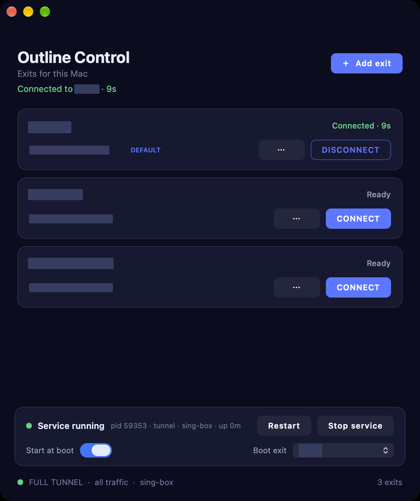

# Outline Control for macOS

[](https://github.com/cjtsh/software-disclaimer)
[](https://github.com/cjtsh/software-disclaimer/blob/main/LICENSE)

A native macOS front end for [Outline](https://getoutline.org) that can be driven
by an API instead of by clicking.



## Why this exists

Outline's desktop client is an Electron app with no CLI and no local API. That
is fine when you are sitting in front of the Mac — and useless when you are not.
If you want a phone, a script, or another program to **connect, disconnect, or
switch exits** on a machine across the internet, the client has to be quovable
from the outside.

So this project splits the job in two:

```
  Outline Control.app  ──HTTP (127.0.0.1:9911)──▶  outline-controld
   (Swift/AppKit, stateless)                        (Go, launchd, owns everything)
                                                          │
                                                          ├── tunnel mode: supervises sing-box
                                                          │   (utun + default route + DNS)
                                                          └── socks mode: supervises sslocal
                                                              (shadowsocks-rust)
```

The **provider** (`outline-controld`) owns the saved exits and the tunnel, and
answers a small JSON API. The **app** is a client of that API and holds no state
of its own — close the window and the tunnel keeps running, which is exactly
what you want if the window is not the thing that matters.

## Requirements

* macOS 13 or newer (Apple silicon or Intel — the provider is a universal binary)
* [shadowsocks-rust](https://github.com/shadowsocks/shadowsocks-rust):
  `brew install shadowsocks-rust`

This project deliberately **does not implement the Shadowsocks cipher**. A
proven binary owns the wire format; we own its lifecycle, its state machine and
its API.

## Two modes

| | **tunnel** | **socks** |
|---|---|---|
| What it captures | every packet on the Mac | only apps pointed at a local SOCKS proxy |
| Engine | [sing-box](https://sing-box.sagernet.org) (`utun`, default route, DNS through the exit) | [shadowsocks-rust](https://github.com/shadowsocks/shadowsocks-rust) |
| Privileges | root LaunchDaemon | your login agent |
| Install | `sudo ./install/install-tunnel.sh` | `./install/install.sh` |

**Tunnel mode is the one that behaves like a VPN.** macOS will not hand out a
`NEPacketTunnelProvider` without an Apple-granted entitlement, so instead of a
Network Extension this mode does what every `utun`-based client does: a
privileged daemon creates the tunnel interface, takes the default route and
forwards packets through the exit. That is why it needs root — and why it
survives logout and reboot.

### Exclusions: the whole point

A VPN you can only fix *through* the VPN is a trap. The tunnel therefore always
keeps a list of destinations that bypass it:

```sh
sudo ./install/install-tunnel.sh \
  --exclude-host relay.example.com \
  --exclude-cidr 203.0.113.10/32
```

Excluded hosts resolve locally and dial directly, so the control channel that
starts and stops this VPN keeps working while the VPN is down, wrong, or being
switched to another exit. Private address space is always routed directly as
well.

## Install

```sh
git clone https://github.com/cjtsh/outline-control-macos.git
cd outline-control-macos
./app/build.sh                                  # app, provider, icon
sudo ./install/install-tunnel.sh                # full-device VPN (recommended)
# or, for the per-app SOCKS proxy:
./install/install.sh
open "/Applications/Outline Control.app"
```

Both installers print the disclaimer and wait for you to accept it (`ACCEPT`, or
`--accept-terms` for unattended runs) before they touch `/Library`. The app shows
the same notice on first launch and records the accepted terms version.

The tunnel installer puts the provider in
`/Library/Application Support/Outline Control/` and runs it as the root
LaunchDaemon `sh.cjt.outline-control` (restarted on crash, started at boot), so
the VPN is available before anyone logs in. Your data stays in
`~/Library/Application Support/Outline Control/`.

Uninstall: `./install/uninstall.sh`.

## Use

* **＋ Add exit** — paste an `ss://` access key from your Outline server. The
  name comes from the key's `#fragment` and can be changed later.
* **CONNECT / DISCONNECT** — one tunnel at a time, like the original client.
* **⋯ → Rename / Forget** — relabel an exit, or delete it from this Mac.
* The footer shows the SOCKS address while connected and the client binary in use.

Exits are checked every few seconds with a TCP probe, so a dead server shows as
**Unreachable** before you click it rather than after.

### The service itself

The bar at the bottom of the window is the daemon, not the app:

| Control | What it does |
|---|---|
| **Start at boot** | Brings the **Boot exit** up by itself when the daemon starts — at login and after a reboot. |
| **Boot exit** | Which saved exit `Start at boot` uses. `None` means never connect on its own. |
| **Restart** | Restarts the daemon (it exits and launchd starts it again). |
| **Stop service** | Releases the tunnel and refuses to auto-connect until you press **Start service**. The daemon stays resident so it can still start the VPN; it just stops doing it on its own. |

The VPN is never held open against your wishes: `Stop service` disconnects
first, then records the decision, so another VPN client is free to take over.
Two presses bring it back (`Start service`), including the boot exit.

## The local API

Everything the app does is available on `http://127.0.0.1:9911`:

| Method | Path | Meaning |
|---|---|---|
| `GET` | `/status` | tunnel state, active exit, SOCKS address, pid, last error |
| `GET` | `/servers` | saved exits (never includes the password) |
| `POST` | `/servers` | `{"key":"ss://…","name":"optional"}` |
| `PATCH` | `/servers/{id}` | `{"name":"Tokyo"}` |
| `DELETE` | `/servers/{id}` | forget an exit (stops the tunnel if it is live) |
| `POST` | `/connect` | `{"id":"…"}` |
| `POST` | `/disconnect` | stop the tunnel |
| `GET` | `/health` | last TCP probe per exit |
| `GET` | `/settings` | `{autoconnect, defaultServer, suspended}` plus service info |
| `PATCH` | `/settings` | any subset of `{"autoconnect":true,"defaultServer":"id","suspended":false}` |
| `POST` | `/service/suspend` | release the tunnel and stop auto-connecting |
| `POST` | `/service/resume` | clear the suspension (connects the boot exit if configured) |
| `POST` | `/service/restart` | restart the daemon through launchd |

Every request needs the token from
`~/Library/Application Support/Outline Control/token`:

```sh
TOKEN=$(cat "$HOME/Library/Application Support/Outline Control/token")
curl -s -H "X-Outline-Token: $TOKEN" http://127.0.0.1:9911/status
```

## Security notes

* The API listens on **127.0.0.1 only** and requires a bearer token stored in a
  `0600` file. Nothing is exposed to the LAN.
* `servers.json` is `0600` because it holds access-key passwords. Back it up like
  a secret.
* There is no command execution surface: the provider runs exactly one binary
  (`sslocal`, or `$OUTLINE_CONTROL_SSLOCAL`) with an argument list built from
  parsed key fields. The cipher is whitelisted; unsupported ones are refused at
  parse time.
* In tunnel mode the daemon runs as root, because taking the default route
  requires it. It never accepts a command to run: the only two binaries it can
  spawn are a fixed `sing-box run -c <config it wrote itself>` and, in socks
  mode, `sslocal` with flags derived from parsed key fields.
* The tunnel is IPv4-only. IPv6 traffic is neither captured nor forwarded.
* Tunnel mode is as strong as your exit: if the exit dies, traffic stops rather
  than falling back to the open network (no silent leak), but there is no `pf`
  kill-switch either.

## Development

```sh
cd provider && go test ./...    # parsing, store permissions, API, tunnel lifecycle
./app/build.sh                  # universal app + provider + generated icon
```

Deliberately dependency-free: the provider is Go standard library only, and the
app is AppKit compiled by the command line tools — no Xcode project, no
SwiftUI macro plugins, no package manager.

## Roadmap

* **Module for Mac Remote** — let the phone start, stop and switch exits through
  the same relay that already reaches this Mac.
* **Network Extension variant** — a `NEPacketTunnelProvider` build for anyone
  with an Apple entitlement: no root, system VPN UI, on-demand rules.
* **Kill switch** — optional `pf` rules so a crash of the tunnel engine cannot
  leak a single packet.

## Disclaimer & Limitation of Liability

This software is provided “AS IS” and without warranties, to the maximum extent permitted by applicable law. Use it at your own risk and maintain appropriate backups. Review and supervise any automated or AI-generated actions before execution. Do not use it in life-safety or other mission-critical settings. The software does not provide professional advice.

To the maximum extent permitted by law, Bitseeker LLC and its members, managers, officers, employees, agents, and contributors disclaim liability for indirect, incidental, special, exemplary, punitive, or consequential damages arising from the software. This does not exclude liability that cannot lawfully be excluded.

> **Additional terms:** The full disclaimer, including its limited indemnity and Wyoming governing-law and forum provisions, is at [cjtsh/software-disclaimer](https://github.com/cjtsh/software-disclaimer/blob/main/DISCLAIMER.md). A link or notice alone may not establish contractual assent. For terms intended to form a contract, present them clearly and obtain affirmative acceptance where required by law.

### What this means in practice

* The first time the app launches it shows the notice in
  [`app/Resources/FIRST-RUN-NOTICE.txt`](app/Resources/FIRST-RUN-NOTICE.txt) and
  will not talk to the daemon until you press **I accept — continue**. The
  accepted terms version is recorded in `UserDefaults`; bumping it re-prompts.
* `DISCLAIMER.md` and `LICENSE` ship inside the app bundle, and the same text is
  available from **Outline Control → Disclaimer and License…** at any time.
* The installer is a command-line tool, so it asks for the same acceptance
  (`ACCEPT`, or `--accept-terms` for unattended runs) before it touches
  `/Library`.
* Nothing here overrides the MIT license; the disclaimer supplements it.

The standard this project follows — including how to update it safely — is
documented in [`AGENTS.md`](AGENTS.md).

## License

MIT, © 2026 Bitseeker LLC. See [`LICENSE`](LICENSE) and [`DISCLAIMER.md`](DISCLAIMER.md).
